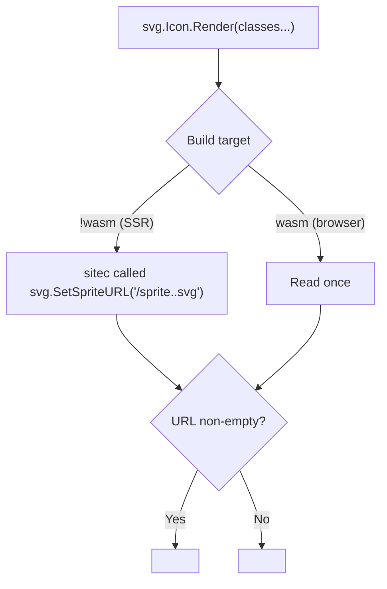

# External Sprite URL Resolution

Context: Under strict `Content-Security-Policy` (`style-src 'self'`, no inline SVG), the merged icon sprite moves out of `index.html` into an external hashed file (`sprite.<hash>.svg`) on the same origin.

## Walkthrough

1. `sitec` writes the merged sprite as `<svg xmlns="http://www.w3.org/2000/svg">...</svg>` into `sprite.<hash>.svg` (without `style="display:none"`).
2. During SSR page rendering, `sitec` sets `svg.SetSpriteURL` so `Icon.Render` emits `<use href="/sprite.<hash>.svg#id"/>`.
3. In the browser (`wasm`), the first `Icon.Render` call reads `<meta name="webtyp-sprite" content="...">` from `<head>` and caches the external URL.
4. In isolated unit tests without `sitec` or `<meta>`, `Icon.Render` falls back to `<use href="#id"/>`.
